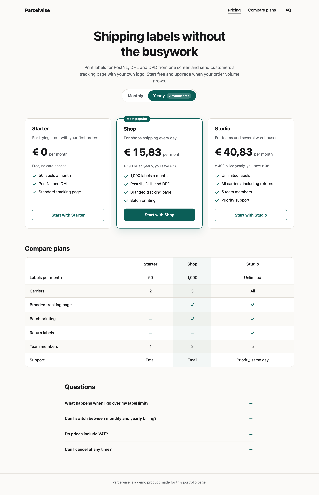
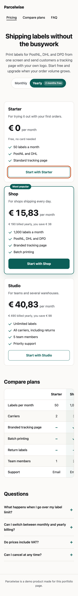

# Accessible Pricing Page

A pricing page for a made-up shipping label service, built with semantic HTML, CSS Grid and about 2 kB of TypeScript. It has a billing toggle, a feature comparison table and an FAQ. Keyboard, screen reader, mobile and high contrast users get the same information as everyone else.

**Live demo:** https://takeshisan19921.github.io/accessible-pricing-page/





## What it shows

- **Real radio buttons styled as a segmented control.** Arrow keys, focus and screen reader announcements work natively, with no ARIA re-implementation.
- **A comparison table that reads correctly.** Headers use `scope`, check marks are `aria-hidden` with "Included" or "Not included" text beside them, and the table scrolls inside its own focusable region on small screens.
- **Changes are announced once.** Switching billing updates a polite live region, and the initial page load stays silent.
- **Shareable state.** `?billing=yearly` opens the page on yearly prices, and the toggle keeps the URL in sync.
- **Skip link, one `h1`, landmark regions and a visible focus style** on every interactive element.
- **`forced-colors` and `prefers-reduced-motion` support.** The selected toggle and the featured plan stay distinguishable in Windows high contrast mode.
- **FAQ with `<details>`**, so it works without JavaScript.

## Pricing rules

A yearly plan charges ten months, so two months are free. The per-month price on the card is rounded down, so twelve times that number never adds up to more than the year costs. A unit test checks this for every plan.

## Two layout bugs worth knowing about

While testing at 390px I found the page was 582px wide. There were two causes:

1. Grid items default to `min-width: auto`, so the 560px comparison table stretched the `main` grid track. The fix is `main > * { min-width: 0; }`.
2. The visually hidden "Included" spans are `position: absolute`. Without a positioned ancestor they escaped the table's scroll container and widened the page. `position: relative` on the wrapper keeps them inside.

## Tech

Semantic HTML, CSS Grid, TypeScript (strict), Vite and Vitest with jsdom. No framework.

## Run it

```sh
npm ci
npm run dev      # http://localhost:5173
npm test         # pricing rules plus DOM and structure tests
npm run build    # typecheck + production build
```

